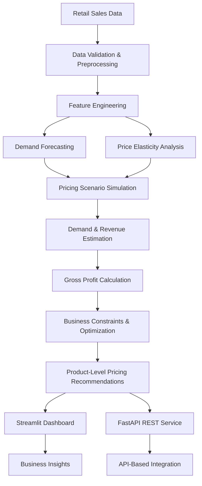

# Intelligent Retail Pricing, Revenue and Profitability Optimization System

**Predict Demand. Optimize Pricing. Maximize Revenue and Profitability.**

## Project Overview

An end-to-end retail analytics and optimization system designed to analyse product demand, estimate price elasticity, simulate pricing scenarios, and identify profitable pricing strategies using Machine Learning and Predictive Analytics. The system integrates demand forecasting, statistical price elasticity analysis, and constrained optimization techniques to evaluate the relationship between product prices, customer demand, revenue, and gross profitability. It leverages **Random Forest Regression and Log-Log Price Elasticity Modelling** to estimate product demand and evaluate potential pricing strategies under configurable business constraints.

An interactive **Streamlit dashboard** and **FastAPI-based REST API** provide capabilities for pricing analysis, revenue simulation, profitability assessment, and intelligent product-level pricing recommendations.

*The current implementation uses synthetic retail data for experimentation. Generated results are illustrative and do not establish real-world pricing improvements.*

## Key Objectives

- Analyse historical retail sales and product pricing patterns.
- Develop machine learning models to estimate product demand.
- Measure price elasticity to understand demand sensitivity to price changes.
- Simulate alternative pricing scenarios and evaluate their financial impact.
- Optimize product prices based on estimated gross profitability.
- Apply configurable pricing constraints to support practical recommendations.
- Enable data-driven pricing and revenue management decisions.

## Key Features

| Feature | Description |
|---|---|
| Retail Data Generation | Generate synthetic product-level retail sales datasets. |
| Data Preprocessing | Validate and prepare pricing, cost, promotion, and sales information. |
| Demand Forecasting | Estimate product demand using Random Forest Regression. |
| Price Elasticity Analysis | Measure price-demand relationships using log-log regression. |
| Pricing Simulation | Evaluate multiple candidate prices and their predicted demand. |
| Revenue Optimization | Estimate revenue under alternative pricing scenarios. |
| Profitability Analysis | Calculate gross profit using predicted demand and unit costs. |
| Pricing Constraints | Apply price floors, ceilings, and maximum price-change limits. |
| Pricing Recommendations | Identify candidate prices with the highest estimated gross profit. |
| Interactive Dashboard | Explore product pricing, demand, revenue, and profitability. |
| REST API | Access pricing scenario calculations through FastAPI. |

## System Architecture

The system follows a structured retail analytics workflow integrating data preparation, predictive modelling, price elasticity estimation, pricing simulation, and profitability optimization.



## Analytical Architecture

The platform integrates multiple analytical components to evaluate pricing decisions and their potential business impact.

### 1. Retail Data Analytics

Processes product-level retail information, including:

- Product and SKU identifiers.
- Historical selling prices.
- Unit costs.
- Sales quantities.
- Promotional indicators.
- Transaction dates.
- Seasonal demand information.

### 2. Demand Forecasting

Uses **Random Forest Regression** to estimate product demand based on historical sales and engineered features.

The model supports the evaluation of expected demand under different pricing scenarios.

### 3. Price Elasticity Analysis

Uses log-log regression to estimate the relationship between product prices and demand.

Price elasticity helps understand how changes in product pricing are associated with changes in estimated demand.

### 4. Pricing Scenario Simulation

Generates multiple candidate prices within configurable pricing boundaries.

Each scenario is evaluated using:

- Predicted demand.
- Estimated revenue.
- Estimated gross profit.
- Price-change constraints.

### 5. Profitability Optimization

Evaluates candidate pricing scenarios and selects the price associated with the highest estimated gross profit while respecting configured business constraints.

## Pricing & Profitability Indicators

The system evaluates several financial and operational indicators.

| Indicator | Description |
|---|---|
| Selling Price | Current or proposed product selling price. |
| Unit Cost | Cost associated with each product unit. |
| Predicted Demand | Estimated product sales quantity. |
| Price Elasticity | Sensitivity of demand to price changes. |
| Revenue | Estimated sales revenue. |
| Gross Profit | Revenue after deducting unit-level product costs. |
| Gross Profit Margin | Gross profit expressed as a percentage of revenue. |
| Price Change | Difference between current and recommended prices. |

## Pricing Optimization Methodology

The optimization engine evaluates candidate prices using predicted demand and financial calculations.

### Revenue Calculation

\[
Revenue = Price \times Predicted\ Demand
\]

### Gross Profit Calculation

\[
Gross\ Profit = (Price - Unit\ Cost) \times Predicted\ Demand
\]

### Gross Profit Margin

\[
Gross\ Profit\ Margin =
\frac{Gross\ Profit}{Revenue}\times 100
\]

### Price Optimization

The system searches candidate prices within configurable boundaries and selects the scenario that produces the highest estimated gross profit.

The optimization process considers:

- Minimum selling price.
- Maximum selling price.
- Maximum permitted price change.
- Predicted demand.
- Estimated revenue.
- Estimated gross profitability.

*The current optimizer is a decision-support baseline. Its recommendations depend on the accuracy of the demand model and the assumptions used in pricing simulation.*

## Technology Stack

| Category | Technologies |
|---|---|
| Programming | Python |
| Data Processing | Pandas, NumPy |
| Machine Learning | Scikit-learn |
| Demand Forecasting | Random Forest Regression |
| Statistical Modelling | Log-Log Regression, Price Elasticity Analysis |
| Visualization | Matplotlib |
| Interactive Dashboard | Streamlit |
| Backend Development | FastAPI, Uvicorn |
| Model Management | Joblib |
| Testing | Pytest |
| Development Environment | Jupyter Notebook, VS Code |
| Version Control | Git, GitHub |

## Methodology

1. **Data Generation & Collection** – Generate or load retail product-level sales data.
2. **Data Validation** – Validate product prices, costs, promotions, dates, and sales quantities.
3. **Exploratory Data Analysis** – Identify pricing patterns, demand trends, and sales distributions.
4. **Feature Engineering** – Develop seasonal, promotional, pricing, and margin-related features.
5. **Demand Modelling** – Train a Random Forest regression model to estimate product demand.
6. **Price Elasticity Estimation** – Apply log-log regression to analyse price-demand relationships.
7. **Model Evaluation** – Evaluate demand prediction performance using appropriate regression metrics.
8. **Pricing Simulation** – Generate and evaluate alternative product pricing scenarios.
9. **Profitability Optimization** – Calculate revenue and gross profit under business constraints.
10. **Recommendation Generation** – Identify suitable candidate prices for each product.
11. **Dashboard & API Integration** – Present analytical results through interactive applications.

## Model Evaluation

Demand forecasting performance is evaluated using regression-based metrics.

| Metric | Purpose |
|---|---|
| MAE | Measures average absolute demand prediction error. |
| RMSE | Penalizes larger prediction errors. |
| R² Score | Measures the proportion of demand variation explained by the model. |

Price elasticity estimates should also be reviewed for coefficient direction, statistical significance, and model fit.

*Actual model performance and elasticity estimates should be reported using measured experimental results.*

## API Usage – Pricing & Profitability Optimization

The FastAPI service provides an endpoint for evaluating product-level pricing scenarios.

### Key Input Parameters

- **Product ID:** Unique product identifier.
- **Current Price:** Existing product selling price.
- **Unit Cost:** Product cost per unit.
- **Historical Demand:** Previous product sales information.
- **Promotion Data:** Applicable promotional indicators.
- **Price Constraints:** Minimum and maximum permitted prices.
- **Maximum Price Change:** Permitted variation from the current price.

### Expected API Outputs

- Recommended candidate selling price.
- Predicted product demand.
- Estimated revenue.
- Estimated gross profit.
- Gross profit margin.
- Pricing scenario comparisons.

API documentation:

`http://127.0.0.1:8000/docs`

## Installation & Quick Start

**1. Clone the repository**

```bash
git clone <your-repository-url>
cd <repository-folder>
```

**2. Create a virtual environment**

```bash
python -m venv venv
```

**3. Activate the environment**

Windows:

```bash
venv\Scripts\activate
```

Linux / macOS:

```bash
source venv/bin/activate
```

**4. Install dependencies**

```bash
pip install -r requirements.txt
```

**5. Generate synthetic retail data**

```bash
python scripts/generate_data.py
```

**6. Execute the analytics pipeline**

```bash
python scripts/run_pipeline.py
```

**7. Launch the Streamlit dashboard**

```bash
streamlit run dashboard/app.py
```

**8. Start the FastAPI backend**

```bash
uvicorn api.main:app --reload
```

**9. Run automated tests**

```bash
pytest -q
```

*Ensure the commands and paths match the actual implementation in your repository.*

## Repository Structure

```text
Retail_Pricing_Optimization/
│
├── api/
│   └── main.py
│
├── config/
│   └── config.yaml
│
├── dashboard/
│   └── app.py
│
├── data/
│   ├── sample/
│   └── processed/
│
├── docs/
│   ├── 01_project_overview.md
│   ├── 02_problem_statement.md
│   ├── 03_objectives_and_scope.md
│   ├── 04_literature_review.md
│   ├── 05_system_architecture.md
│   ├── 06_dataset_documentation.md
│   ├── 07_data_preprocessing.md
│   ├── 08_feature_engineering.md
│   ├── 09_demand_forecasting.md
│   ├── 10_price_elasticity.md
│   ├── 11_pricing_simulation.md
│   ├── 12_revenue_analysis.md
│   ├── 13_profitability_optimization.md
│   ├── 14_model_evaluation.md
│   ├── 15_api_documentation.md
│   ├── 16_dashboard_guide.md
│   ├── 17_testing_and_validation.md
│   ├── 18_responsible_pricing.md
│   ├── 19_limitations_and_future_work.md
│   └── 20_references.md
│
├── notebooks/
│   ├── 01_data_exploration.ipynb
│   ├── 02_data_preprocessing.ipynb
│   ├── 03_feature_engineering.ipynb
│   ├── 04_demand_forecasting.ipynb
│   └── 05_price_optimization.ipynb
│
├── scripts/
│   ├── generate_data.py
│   └── run_pipeline.py
│
├── src/
│   └── retail_pricing/
│       ├── __init__.py
│       ├── data.py
│       ├── features.py
│       ├── models.py
│       ├── elasticity.py
│       ├── optimization.py
│       └── pipeline.py
│
├── tests/
│
├── .env.example
├── .gitignore
├── LICENSE
├── requirements.txt
└── pyproject.toml
```

## Future Enhancements & Roadmap

- Integrate advanced forecasting algorithms such as XGBoost and LightGBM.
- Introduce LSTM-based demand forecasting for sequential retail data.
- Implement product-specific and category-level price elasticity estimation.
- Incorporate competitor pricing and market intelligence.
- Integrate inventory availability and stock constraints.
- Develop promotion and discount effectiveness analysis.
- Introduce causal inference for more reliable pricing impact estimation.
- Implement multi-product and cross-product substitution modelling.
- Develop advanced optimization using mathematical programming.
- Enable automated pricing scenario monitoring and reporting.
- Integrate database storage, Docker, and cloud deployment.

## Responsible Use & Limitations

This project is an educational and research-oriented retail pricing optimization prototype.

- Uses synthetic retail data by default.
- Does not establish real-world pricing improvements.
- Uses simplified demand and price elasticity assumptions.
- Does not currently model competitor pricing, product substitution, or inventory constraints.
- Does not establish causal relationships between price changes and demand.
- Pricing recommendations should be validated using real sales, cost, inventory, competitor, and promotion data.
- Avoid discriminatory or collusive pricing practices.
- Validate pricing strategies through controlled experiments before operational deployment.

## Author

**Mohamed Riyaz S.**  
Integrated M.Tech – Computer Science and Engineering (Business Analytics)  
Vellore Institute of Technology (VIT), Chennai
